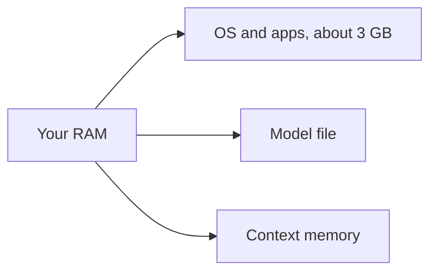

Pick one row of the table below and use that model throughout. The numbers on this page are October 2026 measurements on Apple Silicon; other machines will differ a little.

## Two numbers decide everything

1. **The model file.** About 0.6 GB per billion parameters at Q4_K_M, 1.07 GB at Q8_0, 2 GB at BF16.
2. **The context window's memory.** For the 8B model this is 128 KiB per token, so 0.5 GiB per 4,096 tokens.

Both must fit in RAM next to your operating system and open applications.



## The tiers

| Your memory | Model tag | File | In memory | Context | What it cannot do |
|---|---|---|---|---|---|
| 8 GB | `nishad/apertus:4b` | 2.4 GB | about 2.8 GB | 4,096 tokens (hard limit) | Long documents in RAG; tools only with the wrapped tag; quality below the 8B |
| 16 GB or more | `nishad/apertus:8b` | 5.1 GB | about 5.4 GB at 4k, 6.3 GB at 8k | 8,192 tokens by default, up to 65,536 | Nothing in this workshop |
| 16 GB, curious | `nishad/apertus:8b-v1.5-preview` | 5.1 GB | as the 8B | 8,192 by default | A community conversion; see [Resources](/v3/resources) |


Do not try the 8B on an 8 GB machine. It will swap to disk and every answer will take minutes.


## Speed you can expect

These are estimates for the 8B, in tokens per second. The 4B is roughly twice as fast.

| Machine | Tokens per second (estimate) |
|---|---|
| Base Apple M1, M2 or M4 | about 14 to 24 |
| Apple M-Pro and M-Max | 40 to 80 |
| Windows or Linux laptop, no graphics card, DDR4 | 3 to 7 |
| Windows or Linux laptop, no graphics card, DDR5 | 9 to 14 |

Prompt processing on a CPU is slow: a 2,000-token prompt takes 35 to 80 seconds before the first word appears. This is why Part 2 keeps RAG prompts short on 8 GB machines.

## Special cases

- **Intel Macs** run Ollama on the CPU only, and LM Studio not at all.
- **Windows laptops with integrated Intel or AMD graphics** run on the CPU. Ollama does not use the integrated GPU by default.
- **A laptop NVIDIA card with 6 to 8 GB** fits the 8B only at 4k context.

## Measure your own machine

```bash
ollama run nishad/apertus:8b --verbose
```

Ask one question and read the `eval rate` line. While the model is loaded, `ollama ps` shows SIZE, PROCESSOR (100% GPU or a CPU split) and CONTEXT.


If `eval rate` is above 10 tokens per second you will be comfortable in both halves.


## Why 70B is not on the list

The 70B variant is a 44 GB file. It does not fit on a laptop, and the workshop does not need it.
