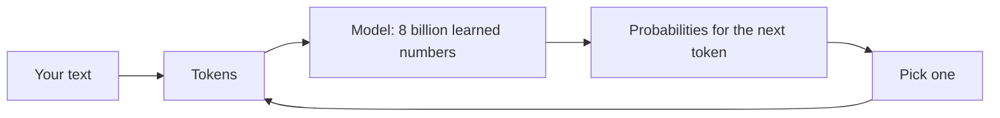

A large language model does one thing: it predicts the next token, again and again.

The chosen token is added to the text, and the loop runs again until the answer is complete.

## The prompting mindset

When you work with an LLM, think of it as:

- **Literal**: it does exactly what you ask, not what you mean.
- **Context-dependent**: it uses only the information you provide.
- **A pattern matcher**: it generates text based on patterns learned from training data.
- **Non-deterministic** (usually): the same prompt can yield different responses.


LLMs don't understand in the human sense; they predict likely continuations. Effective prompting works with this behavior, not against it.


## Before you read on

Will the German sentence cost more or fewer tokens than the English one? Make a guess, then open the first page.

## The pages


  
  
  
  

