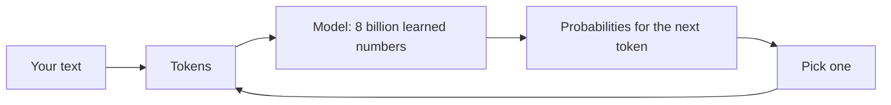

## What you will be able to do

1. Explain in plain words how a model predicts the next token.
2. Say what a token is and why the same sentence costs different amounts in different languages.
3. Connect context window size, parameter count and quantization to memory, file size and speed.
4. Describe what temperature and a seed change in an answer.

A large language model does one thing: it predicts the next token, again and again. A token is a piece of text, often a word or part of a word.

The model adds the chosen token to the text, and the loop runs again until the answer is complete.

## The prompting mindset

Four traits of the model follow from that loop. Every prompting technique in Part 1 is built around them.

- It is **literal**. It does what you asked, not what you meant.
- It knows only **what is in the context**, the text it can see right now. Anything you did not provide, it guesses.
- It is a **pattern matcher**. It continues your text the way its training data (the text it learned from) would.
- It is **not deterministic** unless you make it so. The same prompt can give a different answer next time.


Prompting well means giving the model something good to continue.


## Before you read on

The first page counts the tokens in an English sentence and its German translation. Before you open it, guess: will the German cost more tokens or fewer?

## The pages


  
  
  
  

