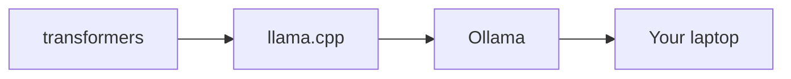

Apertus is the model this workshop uses. This page covers where it comes from, what is open, and what to expect from it.

## Who and when

Apertus comes from the Swiss AI Initiative (EPFL, ETH Zurich and CSCS).

- **Apertus 1.0**, 2 September 2025: 8B and 70B sizes, 15 trillion training tokens, 1,811 languages, a 65,536-token context, Apache-2.0. The technical report is arXiv 2509.14233, accepted at ACL 2026.
- **v1.1 Mini**, May/June 2026: 0.5B, 1.5B and 4B sizes, distilled, with a 4,096-token context.
- **v1.5**, 24 July 2026: image and audio input, a 262,144-token context, optional thinking. The instruct weights are gated behind an acceptable-use policy. The technical report was still pending in October 2026.

## What is open in 1.0

- The weights.
- Data reconstruction scripts (not a hosted corpus).
- The SFT mixture.
- Intermediate checkpoints.
- The training code.
- The EU public training summary, rated A for transparency and A+ for usefulness by an independent assessment.

Two design choices stand out: retroactive robots.txt opt-outs, applied back to crawls from 2013, and a loss trick against verbatim memorisation.

## What to expect

These points come from independent 2026 evaluations. Read them as "what to expect, and why validation matters".

- On general understanding, it is on par with Llama 3.1 8B.
- It is behind on code, maths and instruction following.
- It is strong at extracting fields from documents, and at German.
- The 8B invents a value instead of answering null when a field is missing.
- Faithfulness in RAG is below that of frontier models.


A model that invents a value for a missing field is a reason to validate its output and keep a person in the loop. Part 2 returns to this.


## The acceptable-use policy in plain words

Apertus comes with the Apertus LLM Acceptable Use Policy. In plain words:

- You indemnify ETH and EPFL.
- If you redistribute the model, you pass the policy on.
- An output filter, reviewed every six months, is "strongly advised". That filter does not yet exist.

An OSI forum thread asked whether this fits the Open Source Definition. There has been no ruling.

## Why the workshop teaches 1.0 and only shows 1.5

The workshop uses `nishad/apertus:8b`, which is Apertus-8B-Instruct-2509 in the Unsloth GGUF build. Version 1.5 is shown only as a preview. The reason is the last mile of openness: a model is usable on a laptop only when every link of the support chain has caught up.

For v1.5 the chain is incomplete. There is no official GGUF yet, so the only text-only build is a community conversion, made by hand from the gated checkpoint. Version 1.0 has had native support for a year.

## An audit, in September 2026

A community member audited the published v1.5 SFT data in September 2026 and found benchmark items and duplicates. The team acknowledged it. Openness makes this kind of audit possible.

See [Models](/v3/resources/models) for the exact builds, and the [FAQ](/v3/resources/faq) for common questions.
