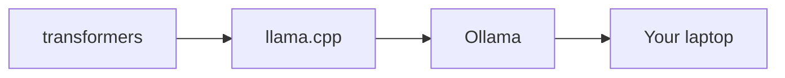

Apertus is the model this workshop uses.

## Who and when

Apertus comes from the Swiss AI Initiative (EPFL, ETH Zurich and CSCS).

- **Apertus 1.0**, 2 September 2025: 8B and 70B sizes (8 and 70 billion parameters, the learned numbers inside the model). It was trained on 15 trillion tokens in 1,811 languages (a token is a piece of text, often a word or part of a word). It has a 65,536-token context window and is released under the Apache-2.0 license. The technical report is arXiv 2509.14233, accepted at ACL 2026.
- **v1.1 Mini**, May/June 2026: 0.5B, 1.5B and 4B sizes, distilled (trained to imitate a larger model), with a 4,096-token context window.
- **v1.5**, 24 July 2026: image and audio input, a 262,144-token context window, and an optional thinking mode (the model can write out its reasoning steps before it answers). The instruct weights (the chat version) are gated: you must accept an acceptable-use policy before you can download them. The technical report was still pending in October 2026.

## What is open in 1.0

- The weights (the model's trained parameters), under the Apache-2.0 license, with an acceptable-use policy (see below).
- Scripts to rebuild the training data (the data itself is not hosted for download).
- The SFT (supervised fine-tuning) mixture: the data that turns the base model into a chat model.
- Intermediate checkpoints (versions of the model saved at points during training).
- The training code.
- The EU public training summary, rated A for transparency and A+ for usefulness by an independent assessment.

Two design choices stand out. First, the team applied robots.txt opt-outs to past crawls as well, going back to 2013. (A robots.txt file is where a website tells crawlers which pages they may not collect.) Second, a change to the training method (the Goldfish loss) discourages the model from reproducing training text word for word.

## What to expect

These points come from independent evaluations in 2026 and from our own runs. They tell you what to expect, and why the checks in Part 2 matter.

- On general understanding, the 1.0 base model (before chat training) is about as good as Llama 3.1 8B.
- The 1.0 instruct model (the chat version) is weaker at code, math and following instructions.
- The independent v1.5 evaluations found it strong at extracting fields from documents, and at German.
- The 8B model sometimes fills a missing field from a neighboring one (for example, a place of publication taken from the publisher) instead of leaving it empty. We saw this in our own runs.
- In RAG (retrieval-augmented generation), the model answers from passages you give it. The v1.5 evaluations found Apertus less faithful to those passages than frontier models (the most capable models of the day).


A model that invents a value for a missing field is a reason to validate its output and to keep a person in the loop: someone who reviews the result before it is used. Part 2 returns to this.


## The acceptable-use policy in plain words

The Apertus LLM Acceptable Use Policy (version 1.0, 1 September 2025) comes with the weights. Three things to know:

- You indemnify ETH and EPFL: if your use of the model leads to legal claims against them, the cost falls on you.
- If you share the model with others, you must pass the policy on to them.
- An output filter, reviewed every six months, is "strongly advised". An output filter is software that checks the model's answers before they reach users. As of October 2026, no such filter had been published.

A thread on the Open Source Initiative (OSI) forum asked whether this policy fits the Open Source Definition. As of October 2026, the OSI had not given a ruling.

## Why the workshop teaches 1.0 and only shows 1.5

The workshop uses `nishad/apertus:8b`, which is Apertus-8B-Instruct-2509 in the GGUF build made by Unsloth. (GGUF is the single-file model format that llama.cpp, Ollama and LM Studio read.) We show version 1.5 only as a preview. The reason is software support: a model runs on a laptop only once every tool in the chain below supports it.

Version 1.0 runs in llama.cpp, Ollama and LM Studio. For v1.5 the chain is incomplete as of 15 November 2026: there is no official GGUF, and the llama.cpp pull request that adds the v1.5 architecture (the model's internal design) is still open. So the only v1.5 builds that Ollama can run are conversions made by community members. They cover only the text part of the model, and there is no check that they match the original.

## An audit, in September 2026

In September 2026, a community member audited the published v1.5 SFT data (the chat training data). The audit found benchmark items (questions from the tests used to score models) and duplicates. The team acknowledged the findings. Openness makes this kind of audit possible.

See [Models](/v3/resources/models) for the exact builds, and the [FAQ](/v3/resources/faq) for common questions.
