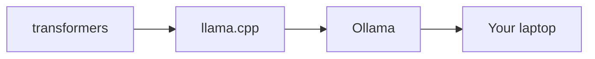

Apertus is the model this workshop uses.

## Who and when

Apertus comes from the Swiss AI Initiative (EPFL, ETH Zurich and CSCS).

- **Apertus 1.0**, 2 September 2025: 8B and 70B sizes, 15 trillion training tokens, 1,811 languages, a 65,536-token context, Apache-2.0. The technical report is arXiv 2509.14233, accepted at ACL 2026.
- **v1.1 Mini**, May/June 2026: 0.5B, 1.5B and 4B sizes, distilled, with a 4,096-token context.
- **v1.5**, 24 July 2026: image and audio input, a 262,144-token context, optional thinking. The instruct weights are gated behind an acceptable-use policy. The technical report was still pending in October 2026.

## What is open in 1.0

- The weights, under Apache-2.0, with an acceptable-use policy (see below).
- Data reconstruction scripts (not a hosted corpus).
- The SFT (supervised fine-tuning) mixture: the data that turns the base model into a chat model.
- Intermediate checkpoints.
- The training code.
- The EU public training summary, rated A for transparency and A+ for usefulness by an independent assessment.

Two design choices stand out: retroactive robots.txt opt-outs, applied back to crawls from 2013, and a change to the training objective (the Goldfish loss) that discourages reproducing training text word for word.

## What to expect

These points come from independent 2026 evaluations and from the workshop's own runs. They tell you what to expect, and why the checks in Part 2 matter.

- On general understanding, the 1.0 base model is on par with Llama 3.1 8B.
- The 1.0 instruct model is behind on code, math and instruction following.
- The independent v1.5 evaluations found it strong at extracting fields from documents, and at German.
- The 8B sometimes fills a missing field from a neighboring one (a place of publication from the publisher) instead of leaving it empty. The workshop's own runs showed this.
- The v1.5 evaluations found faithfulness in RAG below that of frontier models.


A model that invents a value for a missing field is a reason to validate its output and keep a person in the loop. Part 2 returns to this.


## The acceptable-use policy in plain words

The Apertus LLM Acceptable Use Policy (version 1.0, 1 September 2025) comes with the weights. In plain words:

- You indemnify ETH and EPFL.
- If you redistribute the model, you pass the policy on.
- An output filter, reviewed every six months, is "strongly advised". No such filter has been published yet.

An OSI forum thread asked whether this fits the Open Source Definition. There has been no ruling.

## Why the workshop teaches 1.0 and only shows 1.5

The workshop uses `nishad/apertus:8b`, which is Apertus-8B-Instruct-2509 in the Unsloth GGUF build. Version 1.5 is shown only as a preview. The reason is software support: a model runs on a laptop only once every tool in the chain below supports it.

For v1.5 the chain is incomplete. There is no official GGUF yet. Version 1.0 runs in llama.cpp, Ollama and LM Studio today. llama.cpp does not yet support v1.5's architecture, so the only Ollama-ready v1.5 builds are community conversions of the text part, with no check that they match the original.

## An audit, in September 2026

A community member audited the published v1.5 SFT data in September 2026 and found benchmark items and duplicates. The team acknowledged it. Openness makes this kind of audit possible.

See [Models](/v3/resources/models) for the exact builds, and the [FAQ](/v3/resources/faq) for common questions.
