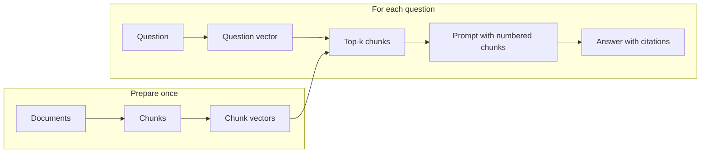

## The problem RAG solves

A model on its own knows what its training data contained, up to a cutoff date. It has not read your finding aids, your policy documents or last month's standard revision. It may also state a wrong detail with full confidence, and it cannot tell you where an answer came from.

With RAG the model answers from passages you supply. That changes four things:

- It can use documents newer than its training data.
- It can use your own documents, which stay on your machine.
- Its answer is grounded in text you can read.
- It can cite which passage it used, so you can check.


A RAG system is only as current as what you indexed. If the standard changed after you built the index, the answers will not show it until you index again.


## The four steps

1. **Prepare once.** Split the documents into chunks, embed each chunk, and keep the vectors with the chunk text and its source.
2. **Retrieve.** Embed the question and take the top-k chunks by similarity.
3. **Augment.** Put the numbered chunks and the question into one prompt, with instructions on how to answer.
4. **Generate.** The model answers and cites the chunk numbers it used.



## Chunking

Embeddings work best on a paragraph-sized piece of text, not a whole book, and a prompt has room for only a few pieces. The documents are therefore cut into chunks that overlap a little, so that a sentence on a boundary is not lost.

| Guideline | Value | Why |
|---|---|---|
| Chunk size | 200 to 500 words | Too small loses context; too large makes retrieval less precise and fills the window |
| Overlap | 10 to 20 percent | A statement cut at a boundary still appears whole in one chunk |

The notebook uses chunks of 300 words with an overlap of 50 words, the defaults of `workshop.rag.chunk_text`. Every chunk keeps its source file and position, such as `dcmi-terms#5`, and that is what a citation points to.

Chunking is a setting you can change. Smaller chunks can find a short definition that a larger chunk buries; larger chunks keep more context together. The exercises on the [pipeline page](/v3/part2/05-rag/pipeline) let you try both.

## The grounded prompt

The prompt that the helper builds starts with these instructions, from `workshop.rag.RAG_INSTRUCTIONS`:

```text
Answer the question using only the numbered documents below. Cite the documents you used as [1], [2] and so on after each statement. If the documents do not contain the answer, say that the documents do not answer the question. Do not use outside knowledge.
```

The numbered chunks follow as `[1] ...`, `[2] ...`, then `Question: ...`. Two parts of this wording matter. The numbering makes a citation checkable: you can open chunk `[2]` and see whether it supports the statement. The refusal sentence gives the model a permitted way out, so it does not have to invent an answer when the documents are silent.

Neither part is a guarantee. A small model follows the instructions most of the time and sometimes does not, as the pipeline page shows with real outputs.

## Retrieval comes first

Generation can only use what retrieval found. If the passage that holds the answer is not in the top-k chunks, no wording of the prompt can fix the answer. When an answer looks wrong, read the retrieved chunks before you change the prompt.

This is why the notebook prints the retrieved chunks before the answer. It is also why the notebook keeps a case where retrieval failed and the answer was wrong: seeing the failure is the lesson.

## RAG compared with fine-tuning

| Aspect | RAG | Fine-tuning |
|---|---|---|
| Setup | Quick: index the documents | Slow: prepare data and train |
| Updates | Index the new documents | Train again |
| Data needed | Any amount | A large, clean dataset |
| Cost | Embedding time and storage | Training compute |
| Citations | Yes, from the chunks | No |
| Best for | Answering from specific, changing documents | Teaching a style or a task format |

Use RAG when the answer is in your documents and the documents change.

## When RAG is not the answer

- **Exact lookups.** The GND number of a person is a fact in a database, not a passage to paraphrase. A model summarizing a chunk can still garble a number.
- **Live data.** A document index is a snapshot. For current data, ask the service itself.
- **Questions across the whole collection.** Top-k chunks cannot count or total over thousands of records.

Exact and live lookups are the bridge to the next chapter: let the model propose a call to a service, and let a person approve it. That is [tool use](/v3/part2/06-tool-use).
