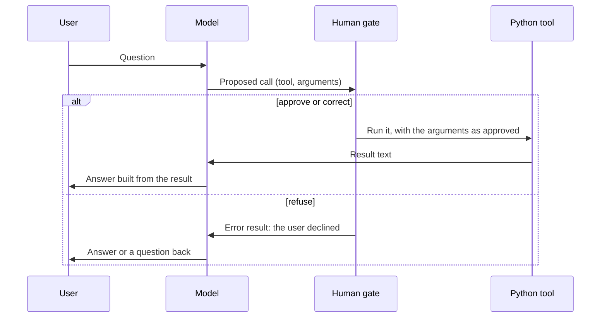

## The loop

The model never runs anything. It returns a structured request, a tool name and arguments, and your program decides what to do with it.

The notebook's loop runs one call per turn. If the model proposes several calls at once, only the first runs, and the result carries a note saying so. The human sees each result before the next call is proposed.

## What Apertus does with tools

Tool calling is where small models are least reliable, so the workshop measured it before building on it. In the 9 October 2026 probe, the 8B produced a structured call for 44 of 44 English prompts, 1 of 9 German prompts and 4 of 6 French prompts, 49 of 59 in all. In the harness run of 15 October 2026 (Ollama 0.35.1, one run per tag):

| Tag | Tool prompts with a structured call | Controls clean | Multi-turn loops | Structured output |
|---|---|---|---|---|
| `nishad/apertus:8b` | 16 of 20 | 10 of 10 | 5 of 5 | 5 of 6 |
| `nishad/apertus:4b` | 11 of 20 | 10 of 10 | 3 of 5 | 5 of 6 |

The four misses of the 8B were two calls that leaked out as text and two prompts where the model made no call. Controls are prompts that should not trigger a tool. The sixth structured-output request is the empty-enum schema, which returns HTTP 400 as expected. The numbers are in the notebooks repository, in `models/README.md`.

There is one more failure to know about. When the model did not call a tool, it sometimes invented a GND number. That is the reason for the gate and for the check described below.

## Why a gate

A model that cannot be trusted to call a tool also cannot be trusted to use the result carefully, and a wrong call can do harm: a query that overloads a public service, a lookup of the wrong person, a number that is accepted because it looks like a GND number. The gate turns a confident guess into a checked fact. You see the exact call before it runs, and you can fix it, as the next page shows with a misspelled name.

## What the loop catches

- **An identifier no tool returned.** If the final answer contains a number that looks like an identifier (a GND number, a Wikidata item such as Q60025, any run of six or more digits) and no tool result contained it, the loop adds `[UNVERIFIED: ... did not come from any tool result.]`. This holds whether the model skipped the tools or invented the number after calling them.
- **A call written as text.** Some model tags write the call as plain text instead of a structured call. The loop stops with an explanation that points to the model tag.
- **A declined call.** Refusing a call becomes an error result that the model sees, so it can ask you instead of guessing.
- **A reply that only announces a call, or says nothing.** The loop gives one reminder ("Call the next tool now, or give your final answer.") and no more.


The check verifies identifiers only. A summary that gets a date, a profession or a nationality wrong passes it. The next page shows an example. Prose about a person has to be checked against the tool message.


## Rules for this model

- **Prompt in English.** The 8B v1 narrates instead of calling when the prompt is not in English.
- **One tool per turn.** Chains are possible, but the model must wait for each result.
- **Never send `think`.** Ollama returns HTTP 400 for both builds.
- **Do not combine tools with `format`.** A request with both a tool list and a `format` or `response_format` suppresses tool parsing.
- **`tool_choice` is ignored** on Ollama's OpenAI-compatible endpoint, so you cannot force a call.

These come from the October 2026 behavior tests. They describe Ollama 0.35.1 and these tags; test again after an upgrade.

## Next

The [human in the loop](/v3/part2/06-tool-use/human-in-the-loop) page runs the loop with real outputs. Services and their etiquette are listed under [Library endpoints](/v3/resources/endpoints). If a long prompt is the problem, see [Limits](/v3/part1/04-prompting/limits) for what small models get wrong.
