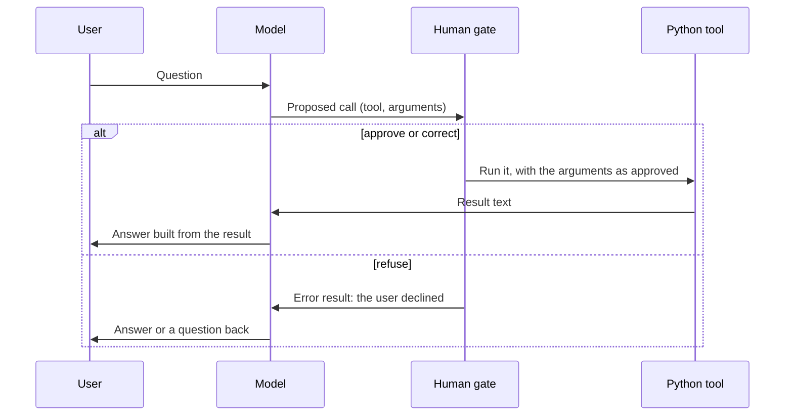

## The loop

The model never runs anything. It returns a structured request (a tool name and its arguments), and your program decides what to do with it.

The notebook's loop runs one call per turn. If the model proposes several calls at once, only the first runs, and the result carries a note saying so. You see each result before the model proposes the next call.

## What Apertus does with tools

Tool calling is where small models are least reliable, so we measured it before building on it. In a test on 9 October 2026, the 8B model produced a structured call for 44 of 44 English prompts, 1 of 9 German prompts and 4 of 6 French prompts, 49 of 59 in all. On 15 October 2026 we ran the test harness, an automated set of checks, once per tag on Ollama 0.35.1 and again on 0.40.4. Both runs gave the same counts:

| Tag | Tool prompts with a structured call | Controls clean | Multi-turn loops | Structured output |
|---|---|---|---|---|
| `thalhath/apertus:8b` | 16 of 20 | 10 of 10 | 5 of 5 | 5 of 6 |
| `thalhath/apertus:4b` | 11 of 20 | 10 of 10 | 3 of 5 | 5 of 6 |

The 8B failed on 4 of the 20 tool prompts: twice it wrote the call as plain text instead of a structured call, and twice it made no call at all. Controls are prompts that should not trigger a tool. The sixth structured-output request uses a schema with an empty enum (a field that allows no values) and returns HTTP 400 as expected. The numbers are in the notebooks repository, in `models/README.md`.

When the model did not call a tool, it sometimes invented a GND number. That is the reason for the gate and for the check described below.

## Why a gate

A model that cannot be trusted to call a tool also cannot be trusted to use the result carefully. A wrong call can do harm: a query that overloads a public service, a lookup of the wrong person, or a number that is accepted because it looks like a GND number. The gate lets a person check each call before it runs. You see the exact call, and you can fix it, as the next page shows with a misspelled name.

## What the loop catches

- **An identifier no tool returned.** The loop checks the final answer for a number that looks like an identifier: a GND number, a Wikidata item such as Q60025, or any run of six or more digits. If no tool result contained that number, the loop adds `[UNVERIFIED: ... did not come from any tool result.]`. This holds whether the model skipped the tools or invented the number after calling them.
- **A call written as text.** Some model tags write the call as plain text instead of a structured call. The loop stops with an explanation that points to the model tag.
- **A declined call.** When you refuse a call, the model receives an error result, so it can ask you instead of guessing.
- **A reply that only announces a call, or says nothing.** The loop gives one reminder ("Call the next tool now, or give your final answer.") and no more.


The check verifies identifiers only. A summary that gets a date, a profession or a nationality wrong passes it. The next page shows an example. You must check the prose about a person against the tool result yourself.


## Rules for this model

- **Prompt in English.** In German the 8B usually describes the call in prose instead of making it (1 of 9 German prompts produced a call; French did better, 4 of 6).
- **One tool per turn.** Chains are possible, but the model must wait for each result.
- **Never send `think`.** Ollama returns HTTP 400 for both builds.
- **Do not combine tools with `format`.** If a request includes both a tool list and a `format` or `response_format`, tool parsing is switched off.
- **`tool_choice` is ignored** on Ollama's OpenAI-compatible endpoint, so you cannot force a call.

These rules come from the October 2026 behavior tests reported above. They apply to these two tags as tested on 15 October 2026 on Ollama 0.35.1 and 0.40.4. Test again after an upgrade.

## Next

The [human in the loop](/v3/part2/06-tool-use/human-in-the-loop) page runs the loop with real outputs. Services and their etiquette are listed under [Library endpoints](/v3/resources/endpoints). If a long prompt is the problem, see [the context budget](/v3/part2/05-rag/pipeline#0407-the-context-budget) in the RAG chapter.
