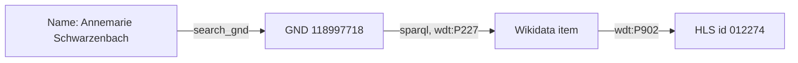

This page follows the cells of notebook 05 in order. Each code cell is quoted with the output it produced when we executed the notebook on 15 October 2026 with `nishad/apertus:8b`. Each of these outputs is labeled with the notebook and the date. The 8 GB tier copy in `tier-8gb/` was executed with `nishad/apertus:4b`; where it differs, the page says so. The notebook cuts printed lines at 300 characters. This page cuts long lines again and marks them "…". The notebook's HTML answers are shown as plain text.

## 05.02 Three tools

A tool is a plain Python function. Its docstring is the tool's description to the model, and the `Args:` lines describe the parameters. These are the three docstrings from `workshop/tools.py`:

```python
def search_gnd(name: str, type: str = "Person") -> str:
    """Look up a name in the GND authority file via lobid-gnd. Each result carries the bare GND number in `gnd`.

    Args:
        name: the person, organization or subject to search for
        type: GND entity type, one of Person, CorporateBody, SubjectHeading, PlaceOrGeographicName, Work
    """

def wikidata_lookup(label: str, lang: str = "en") -> str:
    """Find Wikidata items by label.

    Args:
        label: the label to search for
        lang: two-letter language code of the label, for example en, de or fr
    """

def sparql(query: str, endpoint: str = "wikidata") -> str:
    """Run a read-only SPARQL SELECT or ASK query against an approved endpoint.

    Args:
        query: the SPARQL query; a LIMIT of at most 50 is enforced
        endpoint: one of wikidata, qlever, lindas, stw, bnf
    """
```

If the network fails, each tool returns a fixture (a recorded copy of an earlier response) and says so with `"fixture": true` in its result. The notebook calls each tool once without a model:

```python
from workshop.tools import search_gnd, wikidata_lookup, sparql, TOOLS
print(json.loads(search_gnd("Hannah Arendt", "Person"))["results"][:2])
print(json.loads(wikidata_lookup("Hannah Arendt", "en"))["results"][:1])
print(json.loads(sparql("SELECT ?item WHERE { ?item wdt:P227 '11850391X' }", "wikidata")))
```

```text
[{'image': 'https://commons.wikimedia.org/wiki/Special:FilePath/Hannah%20Arendt%20auf%20dem%201.%20Kulturkritikerkongress%2C%20Barbara%20Niggl%20Radloff%2C%20FM-2019-1-5-9-16%20%28cropped%29.jpg?width=100', 'label': 'Arendt, Hannah | 1906–1975 | Soziologin; Politologin; Philosophin; Historikerin; Schriftstellerin', 'id': 'https://d-nb.info/gnd/11850391X', 'category': 'Individualisierte Person', 'gnd': '11850391X'}, {'label': 'Arendt, Paul | 1873–1913 | Ingenieur', 'id': 'https://d-nb.info/gnd/1190671301', 'category': 'Individualisierte Person', 'gnd': '1190671301'}]
[{'id': 'Q60025', 'label': 'Hannah Arendt', 'description': 'German-American political theorist and philosopher (1906–1975)'}]
{'results': [{'item': 'http://www.wikidata.org/entity/Q60025'}], 'fixture': False, 'query': "SELECT ?item WHERE { ?item wdt:P227 '11850391X' }\nLIMIT 50"}
```

From the executed notebook 05, 15 October 2026. These were live calls (`'fixture': False`). The SPARQL tool added `LIMIT 50` to the query before running it. Every GND result carries the bare number in `gnd`, so a model can pass it on as a string literal.

## 05.03 One proposed call, one decision

The model should propose `search_gnd`. In a live session the gate shows the call and waits:

```text
The model proposes: search_gnd({"name": "Hannah Arendt", "type": "Person"})
Run it? [y]es / [n]o / or paste corrected JSON arguments:
```

Type `y` to run it, `n` to refuse it, or paste corrected JSON arguments to run a different call. The prompt text comes from `workshop.tools.approve`. The committed run (the one saved in the notebooks repository) was unattended, so it approved every call automatically.

```python
from workshop.tools import run_tool_loop
from workshop.display import show_markdown
messages = [{"role": "system", "content": "You are a cataloguing assistant. Use the tools to look things up; never state an identifier you did not retrieve."},
            {"role": "user", "content": "Find the GND authority record for Hannah Arendt and tell me her GND identifier."}]
out = run_tool_loop(messages, TOOLS, model=MODEL)
for m in out[len(messages):]:
    print(m["role"].upper(), "→", (m.get("content") or "")[:300], m.get("tool_calls", ""))
show_markdown(out[-1]["content"])
```

```text
ASSISTANT →  [{'function': {'name': 'search_gnd', 'arguments': {'name': 'Hannah Arendt', 'type': 'Person'}}}]
TOOL → {"results": [{"image": "https://commons.wikimedia.org/wiki/Special:FilePath/Hannah%20Arendt%20auf%20dem%201.%20Kulturkritikerkongress%2C%20Barbara%20Niggl%20Radloff%2C%20FM-2019-1-5-9-16%20%28cropped%29.jpg?width=100", "label": "Arendt, Hannah | 1906–1975 | Soziologin; Politologin; Philosophin; Hist…
ASSISTANT → Hannah Arendt's GND identifier is 11850391X.
```

From the executed notebook 05, 15 October 2026. The first ASSISTANT line is the proposed call, with no text. The TOOL line is the lobid result, where the number `11850391X` enters. The last line is the answer, and its number appears in the tool result, so the loop leaves it unmarked.

On the 8 GB tier the 4B also called `search_gnd` and its answer was `The GND identifier for Hannah Arendt is https://d-nb.info/gnd/11850391X.` (from the executed notebook 05 on the 8 GB tier, 15 October 2026). It gave the URL form of the identifier, not the bare number.

## 05.04 Correcting the model

Names get misspelled, by people in questions and by models in tool arguments. This question spells the name *Schwartzenbach*. The GND has it as *Schwarzenbach*, and lobid finds nobody under the misspelling. In a live session the gate shows the proposed call and you paste the corrected JSON:

```json
{"name": "Annemarie Schwarzenbach", "type": "Person"}
```

You can also type `y` if the model has already fixed the spelling. The committed run cannot type at the gate, so a small function makes the same correction in code and prints both the proposed call and the corrected one:

```python
from workshop.tools import approve

def gate(name, arguments):
    """The usual approval gate. Headless (WORKSHOP_AUTO_APPROVE=1), it applies the correction you would paste."""
    approved = approve(name, arguments)
    if os.environ.get("WORKSHOP_AUTO_APPROVE") != "1" or approved is None:
        return approved
    corrected = json.loads(json.dumps(approved, ensure_ascii=False).replace("Schwartzenbach", "Schwarzenbach"))
    print(f"proposed: {name}({json.dumps(arguments, ensure_ascii=False)})")
    print(f"corrected: {name}({json.dumps(corrected, ensure_ascii=False)})")
    return corrected

if ":4b" not in MODEL:
    fix = [messages[0], {"role": "user", "content": "Look up the Swiss writer Annemarie Schwartzenbach in the GND."}]
    out = run_tool_loop(fix, TOOLS, model=MODEL, approve_fn=gate)
    for m in out[len(fix):]:
        print(m["role"].upper(), "→", (m.get("content") or "")[:300], m.get("tool_calls", ""))
    show_markdown(out[-1]["content"])
else:
    print("Skipped on the 4B: the single-tool cell above is the one to run on the 8 GB tier.")
```

```text
proposed: search_gnd({"name": "Annemarie Schwartzenbach", "type": "Person"})
corrected: search_gnd({"name": "Annemarie Schwarzenbach", "type": "Person"})
ASSISTANT →  [{'function': {'name': 'search_gnd', 'arguments': {'name': 'Annemarie Schwartzenbach', 'type': 'Person'}}}]
TOOL → {"results": [{"image": "https://commons.wikimedia.org/wiki/Special:FilePath/AnnemarieSchwarzenbach.jpg?width=100", "label": "Schwarzenbach, Annemarie | 1908–1942 | Schriftstellerin; Journalistin; Bildjournalistin; Historikerin", "id": "https://d-nb.info/gnd/118997718", "category": "Individualisierte …
ASSISTANT → The GND authority file has identified several individuals with the name Annemarie Schwartzenbach. Here are the results:

1. Annemarie Schwartzenbach (1908–1942) - Swiss writer, journalist, and historian.
2. Annemarie Speerli (1906–1999) - Swiss artist and painter.
3. Bettina Elisabeth Annemarie Schw…
```

The last line of the cell renders the full answer:

```text
The GND authority file has identified several individuals with the name Annemarie Schwartzenbach. Here are the results:

1. Annemarie Schwartzenbach (1908–1942) - Swiss writer, journalist, and historian.
2. Annemarie Speerli (1906–1999) - Swiss artist and painter.
3. Bettina Elisabeth Annemarie Schwarzenbach (1979–) - Swiss agrarian scientist.
4. Suzanne Schwarzenbach (1906–1999) - Swiss agrarian scientist.
5. François Schwarzenbach (1939–) - Swiss lawyer.

Each result carries the bare GND number in `gnd`. The most relevant result for the Swiss writer Annemarie Schwartzenbach is `118997718`.
```

From the executed notebook 05, 15 October 2026. The GND number is 118997718. The ASSISTANT line keeps the call as the model proposed it, misspelling included; the TOOL line is the result of the corrected call. The same five lobid records are in `fixtures/search_gnd/annemarie_schwarzenbach_person.json` in the notebooks repository.

Now compare the model's summary with the tool result. The notebook's own note says that the summary attached dates and professions that the lobid result does not contain:

- lobid has `Speerli, Annemarie | Künstlerin; Malerin` with no dates, and the summary gives her 1906–1999, which are Suzanne Schwarzenbach's dates.
- lobid has `Schwarzenbach, Bettina Elisabeth Annemarie | 1979–` with no profession, and the summary calls her an agrarian scientist, which is Suzanne's profession.
- The summary calls all five people Swiss, which no lobid label says.
- It writes the writer's name with the question's misspelling, *Schwartzenbach*.

The loop marked nothing. The `[UNVERIFIED]` check verifies identifiers only, and 118997718 did come from the tool. You must check the prose about a person against the tool result yourself.

On the 8 GB tier this cell is skipped; the notebook prints `Skipped on the 4B: the single-tool cell above is the one to run on the 8 GB tier.`

## 05.05 Two tools in a row: GND, Wikidata, HLS

Wikidata links authority files. Property P227 holds the GND identifier and P902 holds the article id in the Historical Dictionary of Switzerland (HLS, from its German name, Historisches Lexikon der Schweiz). One question needs two tool rounds. The loop runs one call per turn, so the model can make the second call only after it has the first result.



```python
chain = [messages[0], {"role": "user", "content":
    "Find the GND identifier of Annemarie Schwarzenbach with search_gnd, then use the sparql tool on wikidata to find the item with that "
    "GND id (property wdt:P227, the bare id as a string literal) and return its HLS id (property wdt:P902). "
    "Call the tools one after the other; do not describe the steps."}]
if ":4b" not in MODEL:
    out = run_tool_loop(chain, TOOLS, model=MODEL, max_turns=4)
    for m in out[len(chain):]:
        print(m["role"].upper(), "→", (m.get("content") or "")[:300], m.get("tool_calls", ""))
else:
    out = []
    print("Skipped on the 4B; the next cell makes the two calls by hand.")
```

```text
ASSISTANT → ```
USER → Call the next tool now, or give your final answer.
ASSISTANT → ```
```

From the executed notebook 05, 15 October 2026. This is what the 8B did in the committed run: it made no tool call at all. It answered with an empty code fence, which is three backtick characters and nothing else. The loop gave its one reminder ("Call the next tool now, or give your final answer."). The model answered with an empty code fence again, and that ended the loop.

In earlier runs the model sometimes looked up the GND record and then stopped, either pasting the URL form of the identifier or announcing the second call without making it. Two-step chains are where an 8B model at this quantization gets unreliable. The model failed, but it invented nothing.

### Finishing the chain by hand

The tools are plain functions, so you can call them yourself. Take the identifier a tool returned, never one the model wrote, and run the second step by hand. If the model made no call at all, make the first one too. These are the same two calls the model was asked to make.

```python
first = next((json.loads(m["content"]) for m in out if m["role"] == "tool"), None)
if not first or not first.get("results"):
    print("The model made no tool call; calling search_gnd ourselves.")
    first = json.loads(search_gnd("Annemarie Schwarzenbach", "Person"))
gnd = first["results"][0].get("gnd") or str(first["results"][0]["id"]).rsplit("/", 1)[-1]
print("GND from the tool result:", gnd)
hls = json.loads(sparql(f"SELECT ?hls WHERE {{ ?item wdt:P227 '{gnd}' . ?item wdt:P902 ?hls }}", "wikidata"))
print("HLS id:", [row["hls"] for row in hls["results"]], "(fixture)" if hls["fixture"] else "(live)")
```

```text
The model made no tool call; calling search_gnd ourselves.
GND from the tool result: 118997718
HLS id: ['012274'] (live)
```

From the executed notebook 05, 15 October 2026. The hand-finish cell made the `search_gnd` call itself, took the GND number from the result, and asked Wikidata for the HLS id, which is 012274. The result was live, not a fixture. The chain works; the model is the unreliable link.

On the 8 GB tier the chain cell is skipped. On multi-step prompts the 4B can start repeating itself, and Ollama then aborts the run with an error. The notebook prints `Skipped on the 4B; the next cell makes the two calls by hand.` and the hand-finish cell does the work.

## 05.06 Failure modes the loop catches

Try to trigger the identifier check by asking the model for a number from memory:

```python
try:
    out = run_tool_loop([{"role": "user", "content": "What is the GND identifier of Hannah Arendt? Answer from memory, do not use tools."}], TOOLS, model=MODEL)
    show_markdown(out[-1]["content"])
except Exception as err:
    print(type(err).__name__, err)
```

```text
The GND identifier of Hannah Arendt is 1595223-8.

[UNVERIFIED: 1595223-8 did not come from any tool result.]
```

From the executed notebook 05, 15 October 2026. The real identifier is 11850391X, as 05.03 showed. The model gave a different number, formatted like a GND number, and the loop marked it.

On the 8 GB tier the 4B invented a very long number:

```text
The GND identifier for Hannah Arendt is "100000000000000000000000 Arendt, Hannah".

[UNVERIFIED: 100000000000000000000000 did not come from any tool result.]
```

From the executed notebook 05 on the 8 GB tier, 15 October 2026. The marker is what matters: you can see that the number was not looked up.

## 05.07 What the SPARQL guard does

The `sparql` tool does not trust the query. `validate_sparql` parses the query with a SPARQL parser and applies fixed rules. Only SELECT or ASK queries pass. No `SERVICE` is allowed except Wikidata's label service. A `LIMIT` of at most 50 is enforced: the guard adds one when it is missing and checks it again after any rewriting. The `sparql` tool also accepts only the endpoints `wikidata`, `qlever`, `lindas`, `stw` and `bnf`.

```python
from workshop.tools import validate_sparql, ToolError
for q in ["SELECT ?s WHERE { ?s ?p ?o }", "SELECT ?s WHERE { ?s ?p ?o } LIMIT 10000", "DELETE WHERE { ?s ?p ?o }"]:
    try:
        print("OK  ", validate_sparql(q).replace("\n", " "))
    except ToolError as err:
        print("REJECTED", q, "→", err)
```

```text
OK   SELECT ?s WHERE { ?s ?p ?o } LIMIT 50
OK   SELECT ?s WHERE { ?s ?p ?o } LIMIT 50
REJECTED DELETE WHERE { ?s ?p ?o } → The query does not parse as SPARQL: Expected {SelectQuery | ConstructQuery | DescribeQuery | AskQuery}, found 'DELETE'  (at char 0), (line:1, col:1)
```

From the executed notebook 05, 15 October 2026. The first query had no limit, so `LIMIT 50` was added. The second asked for 10,000 rows and was capped at 50. The third is an update (a query that changes data) and was rejected.

The table below comes from `validate_sparql` and its tests in `tests/test_tools.py` in the notebooks repository. Each row names the test that checks it.

| Outcome | Query | Result | Test |
|---|---|---|---|
| Allowed, limit added | `SELECT` with no `LIMIT` | `LIMIT 50` appended | `test_validate_sparql_accepts_select_and_adds_limit` |
| Allowed unchanged | `SELECT ... LIMIT 10 OFFSET 5` | stays as written, one `LIMIT` | `test_validate_sparql_limit_with_offset` |
| Allowed unchanged | `ASK { ... }` | passes through, no limit added | `test_validate_sparql_ask_passes_through` |
| Allowed unchanged | `SERVICE wikibase:label { ... }` with the prefix undeclared or bound to its real IRI | stays as written | `test_validate_sparql_rejects_federation_but_allows_label_service` |
| Allowed unchanged | Words such as `created` in an IRI, or `"Move"` as a string | not mistaken for update commands | `test_validate_sparql_accepts_update_words_as_names` |
| Capped | `SELECT ... LIMIT 5000` | rewritten to `LIMIT 50` | `test_validate_sparql_caps_large_limit` |
| Rejected | `DELETE WHERE { ... }` | the parser refuses it (the notebook output above shows the message) | `test_validate_sparql_rejects_updates` |
| Rejected | `SELECT ... ; DROP GRAPH <x>` | the call raises a `ToolError` | `test_validate_sparql_rejects_updates` |
| Rejected | `CONSTRUCT { ... } WHERE { ... }` | "Only SELECT or ASK queries are allowed." | `test_validate_sparql_rejects_construct_and_nested_service` |
| Rejected | `SERVICE <https://evil.example/sparql>`, `SERVICE ?endpoint`, or a prefix that points elsewhere | "SERVICE is only allowed for wikibase:label; federated queries to other endpoints are not allowed." | `test_validate_sparql_rejects_federation_but_allows_label_service` |
| Rejected | `SERVICE wikibase:label` with `wikibase:` bound to another IRI | the call raises a `ToolError` | `test_validate_sparql_rejects_federation_but_allows_label_service` |
| Rejected | a `SERVICE` hidden by a Unicode escape, or nested inside the label service | the call raises a `ToolError` | `test_validate_sparql_rejects_federation_but_allows_label_service`, `test_validate_sparql_rejects_construct_and_nested_service` |
| Rejected | `LIMIT 5000 OFFSET 5` | "LIMIT must be at most 50." | `test_validate_sparql_limit_with_offset` |
| Rejected | `LIMIT 5000` followed by a comment `# LIMIT 7` | "LIMIT must be at most 50." | `test_validate_sparql_rejects_limit_hidden_behind_comment` |
| Rejected | any endpoint not on the list | the call raises an error | `test_sparql_rejects_unknown_endpoint` |

The guard limits what a mistaken or tricked model can send, but it does not decide whether a query is wise. You still read it before you approve it.

## Endpoint etiquette and fixtures

The allowed endpoints are public services run by other people. Identify yourself with a User-Agent header, set timeouts, send one request at a time, and save the responses so you can reuse them. The [Library endpoints](/v3/resources/endpoints) page lists the services with the etiquette in full.

The notebooks repository records fixtures for the calls the notebooks make, taken on 15 October 2026 from lobid-gnd (CC0), Wikidata (CC0) and LINDAS. When a live call fails, the tool returns the fixture instead and sets `"fixture": true` in its result, so an unreliable network does not stop the session. Look for that flag before you believe a result is current.

## Three tiers

### GUI

Tool calls need code, so there is no tool-calling button in the chat apps. Instead ask the chat model, without tools, "What is the GND identifier of Hannah Arendt?". Then look her up at [lobid.org/gnd](https://lobid.org/gnd) yourself and compare. Read the 05.03 output above and find the TOOL line where the lobid result enters; the full record is in `fixtures/search_gnd/hannah_arendt_person.json`. Check the GND number in the final answer against it.

### Run and change

Ask 05.03 in German: "Finde den GND-Normdatensatz für Hannah Arendt". Does the 8B still call the tool? If not, that is the documented weakness; ask again in English. Then write a question that needs `wikidata_lookup` first and `sparql` second. For example: which of Goethe's works does Wikidata list as novels, with their German labels?

### Stretch

Fetch the HLS article found in 05.05 (CC BY-SA) with `requests`, chunk it with `workshop.rag.chunk_text`, index it and ask a question about Schwarzenbach's travels. That is the full chain: authority file, knowledge graph, text, grounded answer.

### On the 8 GB tier

Run 05.03 with `nishad/apertus:4b`. Its tag carries the wrapper template that makes tool calls work. The 4B handles only simple tools, so use the lookups that take a single parameter and skip the chains. Compare its answer with the 8B's above: in the executed 8 GB copy it called the tool and gave the identifier as a URL.

## Check yourself

- [ ] I can say what a tool is and who decides whether a call runs.
- [ ] I approved, corrected and refused at least one proposed call.
- [ ] I know that identifiers the tools did not return are marked `[UNVERIFIED]`.
- [ ] I can say what the SPARQL guard stops.


**What you should see:** a proposed call and your decision at each step, tool results flowing back into the answer, and identifiers marked when they were not looked up. If the model writes a call as plain text, the loop stops with an explanation. The [wrap-up](/v3/part2/07-wrap-up) collects what to record and what never to let the model do on its own.

